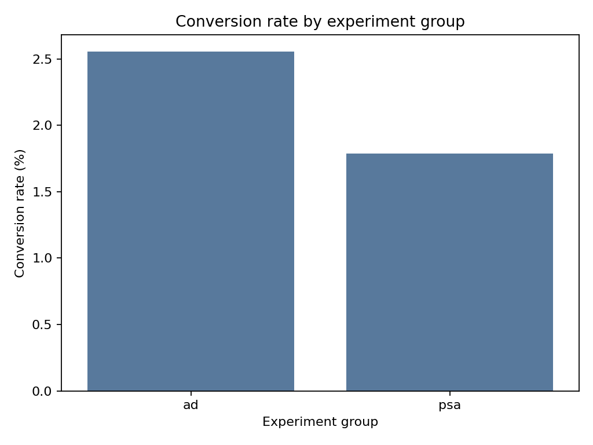

# Marketing A B Test Analysis

A statistical experiment analysis using Kaggle's **Marketing A/B Testing** dataset. The project asks whether showing an advertisement instead of a public-service announcement increased conversion.

## Decision question

Did the advertisement create a statistically significant and practically meaningful improvement in conversion?

## Approach

1. Validate unique users, treatment groups and outcome values.
2. Calculate users, conversions and conversion rate by group.
3. Measure absolute uplift and relative uplift.
4. Calculate a 95% confidence interval for the conversion-rate difference.
5. Run a chi-square test of independence.
6. Translate the result into incremental conversions per 10,000 users.

## Results

The advertisement group converted at **2.55%**, compared with **1.79%** for the control group. The absolute uplift was **0.77 percentage points** (95% CI: 0.60 to 0.94), equivalent to about **77 additional conversions per 10,000 users**. The chi-square test was statistically significant (`p < 0.001`).



## Repository structure

```text
marketing_AB.csv.gz         Compressed Kaggle dataset
marketing_ab_test_analysis.py       Reproducible experiment analysis
marketing_ab_test_analysis.ipynb    Executed Jupyter notebook for step-by-step review
requirements.txt            Python dependencies
outputs/                    Results and visualisations
```

## How to run

```bash
python -m venv .venv
source .venv/bin/activate
pip install -r requirements.txt
python marketing_ab_test_analysis.py
```

To review interactively, open `marketing_ab_test_analysis.ipynb` in Jupyter and run all cells from the project folder.

## Data source

Kaggle dataset: [Marketing A/B Testing](https://www.kaggle.com/datasets/faviovaz/marketing-ab-testing)

The treatment group (`ad`) saw advertisements and the control group (`psa`) saw public-service announcements.

## Skills demonstrated

Python, pandas, experiment design, conversion analysis, confidence intervals, chi-square testing, data visualisation and business recommendations.
